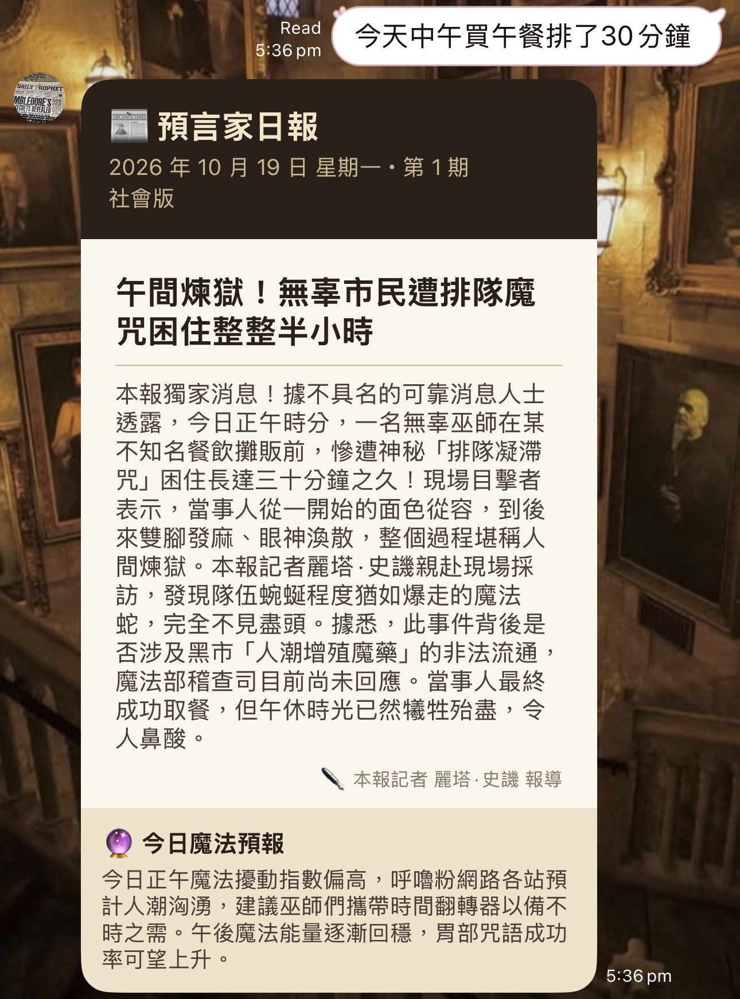
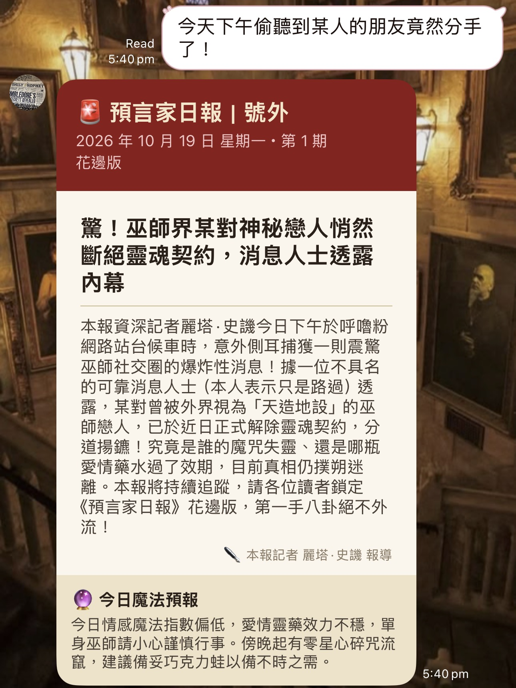
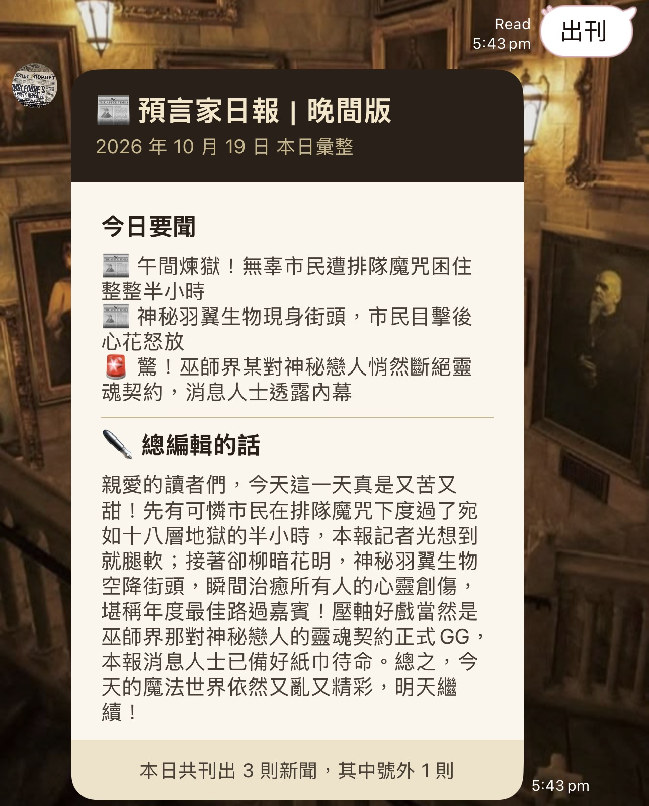
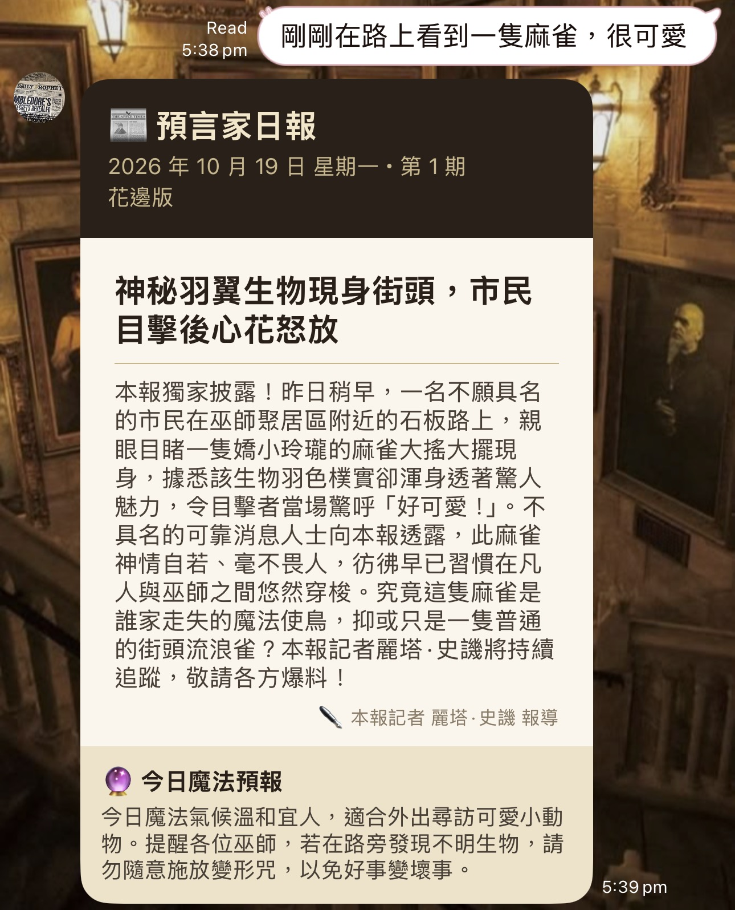
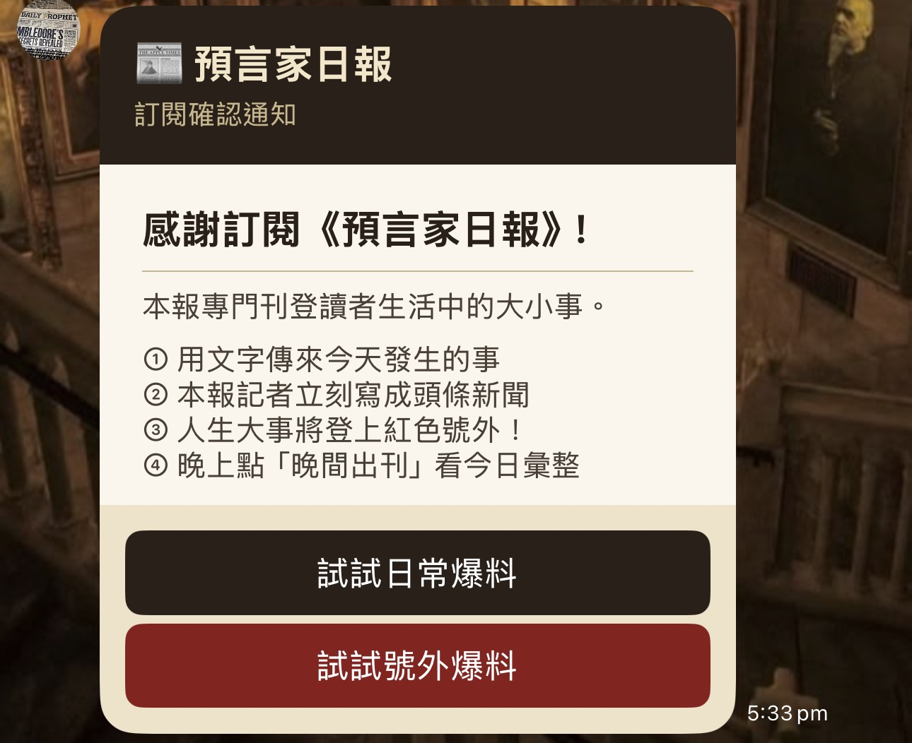
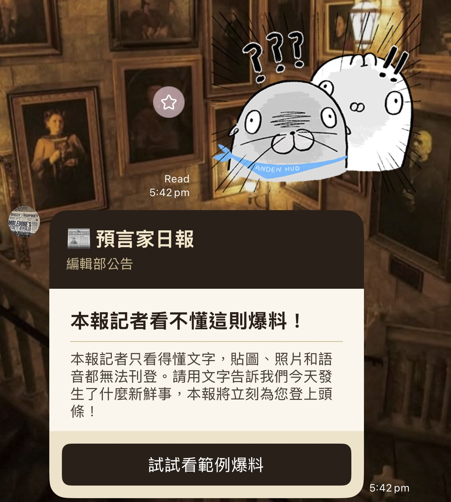
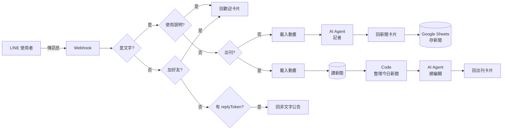
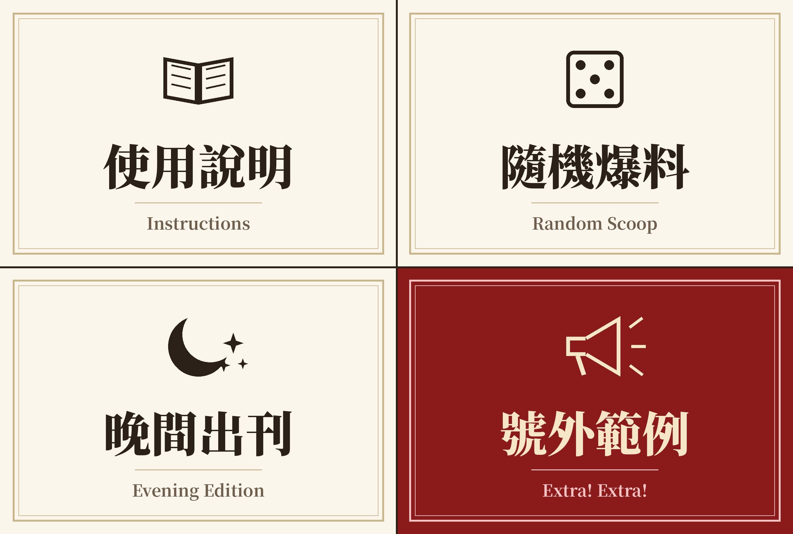

# 📰 預言家日報⚡

> 把你的日常寫成巫師世界頭條的 LINE 機器人

在 LINE 傳一句今天發生的事，本報記者麗塔·史譏就會把它寫成一則誇張又八卦的巫師報紙新聞。

本專案使用 **n8n** 串接 **LINE Messaging API** 與 **AI Agent**。


---

## ✨ 功能

| 功能 | 說明 |
|---|---|
| 📰 日常新聞 | 傳任何事件，回一張報紙風格的 Flex Message 卡片，含版別、標題、內文、記者署名與今日魔法預報 |
| 🚨 號外模式 | AI 判斷事件是否為人生大事，是的話報頭變成紅色號外 |
| 🌙 晚間出刊 | 新聞存進 Google Sheets，傳「出刊」即彙整成當天晚報，並由「總編輯」AI 撰寫總結 |
| 🎲 隨機爆料 | AI 自己編一件好笑的日常小事寫成新聞 |
| 🎛️ 圖文選單 | 使用說明、隨機爆料、晚間出刊、號外範例四個按鈕 |
| ✉️ 歡迎卡片 | 加好友時自動回覆訂閱確認與玩法說明 |
| 🙅 非文字訊息處理 | 傳貼圖或圖片時，回覆「本報記者只看得懂文字」公告卡片 |
| ⏳ 載入動畫 | AI 撰寫時顯示 LINE 的載入動畫 |
| 📅 日期與期數 | 報頭自動顯示日期、星期與期數，同一天為同一期 |

## 📷 截圖

| 一般新聞 | 號外 | 晚間出刊 |
|---|---|---|
|  |  |  |

| 一般新聞（二） | 歡迎卡片 | 非文字訊息公告 |
|---|---|---|
|  |  |  |

## 🏗️ 架構



設計重點：

1. **IF 節點分流**：LINE 會傳來文字、貼圖、加好友、封鎖等各種事件，先分流再處理，避免出錯。
2. **結構化輸出**：用 Structured Output Parser 讓 AI 輸出 `section`、`headline`、`article`、`forecast`、`extra` 欄位，再填入 Flex Message。
3. **AI 負責創意、程式負責規則**：號外由 AI 判斷，期數、日期與新聞篩選由程式計算。

## 📁 檔案結構

```
.
├── README.md
├── workflow/
│   └── daily-prophet-workflow.json   # n8n workflow（已移除所有金鑰）
└── assets/
    ├── richmenu.png                  # 圖文選單圖片（2500 × 1686）
    └── screenshots/                  # 作品截圖（LINE 對話）
```

## 🚀 自己架一個

### 1. 準備

- n8n（本專案使用 n8n Cloud）
- LINE Official Account 與 Messaging API channel
- AI 模型 API（本專案使用 Anthropic Claude）
- Google 帳號（Google Sheets）

### 2. 設定 LINE

1. 在 LINE Official Account Manager 啟用 Messaging API。
2. 在 LINE Developers Console 發行 **Channel access token (long-lived)**。
3. 關閉自動回應訊息與加入好友的歡迎訊息。

### 3. 建立 Google Sheets

新增一份試算表，第一列填入以下欄位：

| date | userId | section | headline | extra |
|---|---|---|---|---|

### 4. 匯入 workflow

1. 在 n8n 新增 workflow，選 **Import from File**，匯入 `workflow/daily-prophet-workflow.json`。
2. 替換以下佔位文字：

| 佔位文字 | 替換成 | 位置 |
|---|---|---|
| `YOUR_LINE_CHANNEL_ACCESS_TOKEN` | 你的 LINE token | 所有 HTTP Request 節點的 Authorization header |
| `YOUR_GOOGLE_SHEET_ID` | 你的試算表 | 「存新聞」、「讀新聞」節點 |

3. 重新設定 Google Sheets 與 AI 模型的 credential。

> 💡 建議把 LINE token 存成 n8n 的 **Header Auth credential**（Name：`Authorization`，Value：`Bearer <token>`），再讓所有 HTTP Request 節點使用它，就不會在匯出時帶出 token。

### 5. 接通

1. 複製 Webhook 節點的 **Production URL**，貼到 LINE Developers Console 的 Webhook URL，開啟 **Use webhook**。
2. 啟用 workflow。
3. 到 LINE Official Account Manager 建立 2×2 大型圖文選單，上傳 `assets/richmenu.png`，四格動作類型都選「文字」：

| 位置 | 文字 |
|---|---|
| 左上 | `使用說明` |
| 右上 | `隨機爆料` |
| 左下 | `出刊` |
| 右下 | `我考上研究所了！` |



## 🔮 未來規劃

- [ ] 串接中央氣象署開放資料，讓魔法預報變成真實天氣預報
- [ ] 依版別或用 AI 生成新聞配圖
- [ ] 加上「改寫成八卦版、體育版」的快速回覆按鈕

## 📝 聲明

本專案為個人學習用的同人作品，靈感來自《哈利波特》系列，與原著作者及版權方無關。新聞內容皆由 AI 依使用者輸入即時生成，不引用原著內文。
